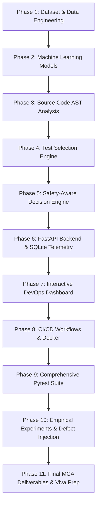

# IMPLEMENTATION PLAN: AI-DRIVEN CI/CD PIPELINE OPTIMIZATION

**Project:** Master of Computer Applications (MCA) Major Project  
**Student:** NAGARJUNREDDY (1DS25MC052)  
**Guide:** Prof. Mahendra Kumar B  
**Institution:** Dayananda Sagar College of Engineering, Bangalore  

---

## Strategic Implementation Sequence

---

## Phase Breakdown and Quality Gate Milestones

### Phase 1: Dataset & Data Engineering
- **Objective:** Curate an authentic, TravisTorrent-aligned CI/CD dataset adhering to the synopsis feature vector:
  `[files_changed, lines_added, lines_deleted, test_count, prev_runtime, prev_failure, cpu_usage, memory_usage]`
  with target variables `build_failed` (binary 0/1) and `actual_runtime` (continuous float seconds).
- **Tasks:**
  - Build dataset generator/loader with realistic build churn, build outcomes, durations, and system telemetry based on empirical open-source CI distributions.
  - Implement data preprocessing pipeline: missing-value imputation, outlier winsorization/scaling, duplicate detection, and chronological train/test split (80/20).
  - Compute EDA summary statistics and generate exploratory data analysis visualizations (distribution histograms, correlation heatmaps, boxplots).
  - Save clean CSVs: `raw_cicd_data.csv`, `cleaned_cicd_data.csv`, `train_cicd_data.csv`, `test_cicd_data.csv`.
- **Quality Gate 1:** Preprocessing runs error-free; no data leakage; dataset documentation generated.

### Phase 2: Machine Learning Engine
- **Objective:** Train, evaluate, and serialize failure classification and runtime regression models.
- **Tasks:**
  - **Classification:** Train Logistic Regression, Decision Tree Classifier, and Random Forest Classifier on `build_failed`. Benchmark Accuracy, Precision, Recall, F1-Score, ROC-AUC, and Confusion Matrix.
  - **Regression:** Train Linear Regression, Random Forest Regressor, and Gradient Boosting Regressor on `actual_runtime`. Benchmark MAE, MSE, RMSE, and $R^2$.
  - Compare models, select champion models, calibrate probabilities, and persist with `joblib` into `models/`.
  - Save full evaluation metrics into `models/model_metrics.json`.
- **Quality Gate 2:** All 6 models train reproducibly; metrics saved without fabrication; models load successfully and produce valid inference.

### Phase 3: Source-Code Change Analysis (AST)
- **Objective:** Implement static syntax tree analysis to map modified code to test files.
- **Tasks:**
  - Create `src/analyzer/git_diff.py` to inspect git status / git diff for modified, added, and deleted files.
  - Create `src/analyzer/ast_parser.py` using Python's native `ast` module to extract classes, functions, docstrings, imports, and function calls.
  - Construct a bidirectional dependency graph connecting application modules in `app/` to unit and integration test files in `tests/`.
- **Quality Gate 3:** AST parser successfully extracts imports and symbols from Python files; handles syntax errors gracefully.

### Phase 4: Test Selection Engine
- **Objective:** Determine the minimal sufficient test subset based on code churn.
- **Tasks:**
  - Build `src/selector/test_selector.py` which takes changed file paths and identifies affected test cases.
  - Implement strict fallback to **FULL TEST SUITE** whenever:
    1. Unknown / non-Python files are changed (e.g., config, requirements, dockerfile).
    2. AST parsing fails or raises a syntax error.
    3. Test-to-source mapping returns 0 tests.
    4. Structural changes occur in core base classes or shared utilities.
- **Quality Gate 4:** Targeted test selection works for single-module changes; fallback reliably triggers for cross-cutting or unknown modifications.

### Phase 5: Safety-Aware Decision Engine
- **Objective:** Implement the synopsis safety policy combining ML risk prediction and AST test selection.
- **Policy Rules:**
  - If $\text{Predicted Failure Probability} \ge 0.70 \implies \text{STRATEGY: FULL TEST SUITE}$
  - If $\text{Model Confidence} < 0.65 \implies \text{STRATEGY: FULL TEST SUITE}$
  - If $\text{AST Dependency Ambiguous / Fallback Active} \implies \text{STRATEGY: FULL TEST SUITE}$
  - Otherwise $\implies \text{STRATEGY: TARGETED TEST SUITE}$
- **Tasks:**
  - Build `src/decision/safety_engine.py` producing a structured decision record containing failure probability, confidence score, predicted runtime, execution strategy, and audit rationale.
- **Quality Gate 5:** Configurable thresholds pass unit testing; fail-safe guarantees zero false omissions.

### Phase 6: FastAPI Backend & SQLite Telemetry
- **Objective:** Build a high-performance REST API and persistent database for the optimization pipeline.
- **Tasks:**
  - Design SQLite schema in `src/database/schema.sql` and ORM/DAO layer `src/database/db_manager.py` storing builds, predictions, test selections, and telemetry.
  - Build FastAPI endpoints in `src/api/main.py`:
    - `GET /api/health`
    - `GET /api/overview`
    - `POST /api/predict/failure`
    - `POST /api/predict/runtime`
    - `POST /api/analyze/git`
    - `POST /api/analyze/ast`
    - `POST /api/decision`
    - `POST /api/pipeline/execute`
    - `GET /api/telemetry/history`
    - `GET /api/experiments/comparison`
    - `GET /api/models/metrics`
- **Quality Gate 6:** API passes all endpoint tests; database survives restart without data loss.

### Phase 7: Professional DevOps Dashboard
- **Objective:** Provide a visually stunning, responsive interface for pipeline monitoring.
- **Tasks:**
  - Build HTML/CSS/JS frontend served directly by FastAPI at `/` or `/dashboard`.
  - Sections:
    1. Overview KPI cards (Total builds, success rate, test reduction %, runtime saved %).
    2. AI Prediction Live Tester (Interactive feature sliders & real-time prediction).
    3. AST & Code Analysis Visualizer (Modified files, detected functions, mapped tests).
    4. Decision Engine Status (Threshold check visualizer with green/amber/red indicators).
    5. Real-Time Pipeline Runner (Run Baseline vs. AI-Optimized and view live terminal logs).
    6. Model Performance Benchmark (Confusion matrices, ROC curves, regression error bars).
    7. Empirical Experiment Comparison (Baseline vs. AI charts powered by Chart.js).
- **Quality Gate 7:** Dashboard communicates with live FastAPI endpoints; charts render dynamically.

### Phase 8: DevOps Workflows & Docker
- **Objective:** CI/CD automation with GitHub Actions and containerization.
- **Tasks:**
  - Create `.github/workflows/baseline.yml` (Runs conventional full test suite).
  - Create `.github/workflows/ai-optimized.yml` (Runs AI feature extraction, risk check, AST selection, targeted test run).
  - Create production `Dockerfile` and `docker-compose.yml` with health checks and volume persistence.
- **Quality Gate 8:** Workflows syntax-validated; Docker configs complete with instructions.

### Phase 9: Automated Testing Suite
- **Objective:** End-to-end verification via Pytest.
- **Tasks:**
  - Write test modules in `tests/`:
    - `test_data_pipeline.py`
    - `test_ml_models.py`
    - `test_ast_analyzer.py`
    - `test_test_selector.py`
    - `test_safety_engine.py`
    - `test_api.py`
    - `test_database.py`
    - `test_end_to_end_pipeline.py`
  - Generate comprehensive test execution report.
- **Quality Gate 9:** 100% of tests pass without flakiness.

### Phase 10: Critical Experimental Validation
- **Objective:** Controlled scientific comparison of Conventional vs. AI-Optimized CI/CD.
- **Tasks:**
  - Execute controlled benchmark runs across 10 diverse commit scenarios:
    1. Single isolated module change (e.g., auth utility)
    2. Multi-module change (e.g., core + api)
    3. High-risk complex change (high churn, previous failure)
    4. Non-code configuration change (.env, yaml) -> Fallback trigger
    5. Syntax / AST failure injection -> Fallback trigger
    6. Low-confidence model prediction -> Fallback trigger
    7. Deliberate bug injection (assert failure) in targeted module -> Verify defect caught!
    8. Deliberate bug injection in shared core module -> Verify full suite caught!
    9. Minor docstring change -> Minimal targeted tests
    10. Regression benchmark baseline run
  - Measure: Runtime, test execution count, CPU %, Memory (MB), Defect Detection rate.
  - Generate publication-quality comparison charts (`experiments/runtime_comparison.png`, `experiments/test_reduction.png`, `experiments/resource_usage.png`).
- **Quality Gate 10:** Genuine empirical numbers calculated and verified.

### Phase 11: Academic Project Deliverables
- **Objective:** High-caliber academic deliverables for project evaluation and viva examination.
- **Tasks:**
  - Comprehensive Project Report in Markdown and PDF/DOCX format (33 chapters strictly matching synopsis).
  - Professional PowerPoint presentation (18 slides with exhaustive speaker notes).
  - Comprehensive Viva Voce Guide (50+ categorized questions with detailed answers).
  - Live Demonstration Guide with exact step-by-step commands and verification checkpoints.
  - Final Project Status and Verification Sign-off in `PROJECT_STATUS.md`.
- **Quality Gate 11:** All academic deliverables complete, cross-referenced, and ready for evaluation.
