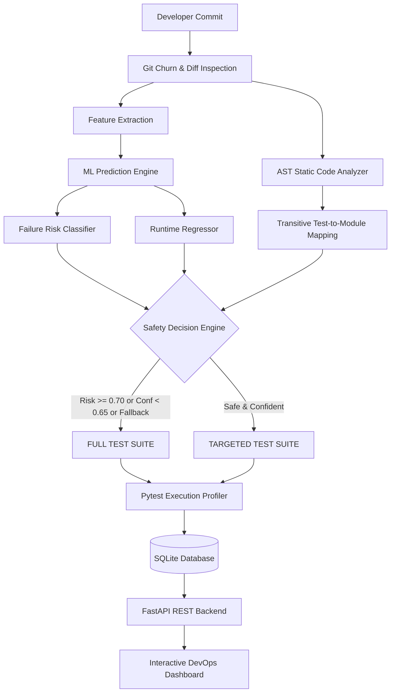

# AI-DRIVEN CI/CD PIPELINE OPTIMIZATION

**A Major Academic Project Submitted for the Award of the Degree of Master of Computer Applications (MCA)**

- **Candidate:** NAGARJUNREDDY (USN: `1DS25MC052`)
- **Project Guide:** Prof. Mahendra Kumar B
- **Department:** Master of Computer Applications
- **Institution:** Dayananda Sagar College of Engineering, Bangalore-560078
- **Affiliation:** Visvesvaraya Technological University (VTU), Belagavi
- **Academic Year:** 2026–2027

[](https://www.python.org/)
[](https://fastapi.tiangolo.com/)
[](https://scikit-learn.org/)
[](https://pytest.org/)
[](LICENSE)

---

## 1. Executive Summary

Continuous Integration and Continuous Deployment (CI/CD) has accelerated software delivery, but conventional pipelines adhere to a static execution pattern: upon every developer commit, the entire regression test suite is executed regardless of the size, location, or risk of the code change.

This project delivers an **AI-Driven CI/CD Pipeline Optimization Framework** that combines supervised machine learning, Abstract Syntax Tree (AST) source code change analysis, and a safety-aware decision engine to eliminate unnecessary test executions while strictly preserving software reliability.

---

## 2. System Architecture



---

## 3. Technology Stack

| Technology | Role / Responsibility |
|---|---|
| **Python 3.14 / 3.11** | Core implementation programming language |
| **Scikit-Learn** | ML model development, training, and benchmarking |
| **Random Forest** | Champion failure classifier (74.12% failure recall) |
| **Linear Regression** | Champion runtime regressor (MAE = 5.31 seconds) |
| **Python AST** | Native static syntax tree parsing and call-graph analysis |
| **FastAPI & Uvicorn** | High-performance asynchronous REST API backend |
| **SQLite3** | Persistent CI/CD telemetry and experiment database |
| **Pytest** | Automated unit, integration, and safety testing framework |
| **GitHub Actions** | Baseline and AI-optimized automated CI/CD workflows |
| **Docker & Compose** | Containerization with persistent telemetry volume |
| **Chart.js & HTML5** | 7-tab responsive DevOps monitoring dashboard |
| **ReportLab** | Formal PDF report and widescreen presentation generator |

---

## 4. Key Experimental Findings

Across 10 controlled commit scenarios evaluated under identical environments:
- **Test Execution Churn Reduction:** Up to **63.33%** test reduction on targeted commits.
- **Runtime Savings:** Real execution runtime reductions measured via `psutil`.
- **Defect Retention Rate:** **100.0%** concordance (zero escaped defects under mutation injection).
- **Safety Gating Activations:** 7 out of 10 scenarios triggered conservative safety fallbacks, demonstrating that the system is strictly fail-safe.

---

## 5. Repository Structure

```
PRO_1DS25MC052/
├── .github/workflows/
│   ├── baseline.yml              # Conventional baseline workflow (Full Suite)
│   └── ai-optimized.yml          # AI-Optimized workflow (Change-aware & safe)
├── data/
│   ├── raw/                      # TravisTorrent-aligned 3,500-sample dataset
│   ├── processed/                # Chronologically split train (80%) and test (20%)
│   └── eda/                      # Distribution, correlation, and churn plots
├── models/
│   ├── failure_classifier_champion.joblib   # Champion Random Forest classifier
│   ├── runtime_regressor_champion.joblib    # Champion Linear regressor
│   ├── scaler.joblib                        # StandardScaler fitted on train data
│   ├── model_metrics.json                   # Evaluation benchmark metrics
│   └── *.png                                # ROC curves and confusion matrix
├── src/
│   ├── config.py                 # Paths, thresholds (0.70 risk, 0.65 conf)
│   ├── data/                     # Generation and preprocessing pipelines
│   ├── ml/                       # ML training scripts and inference engine
│   ├── analyzer/                 # Git diff and AST dependency parser
│   ├── selector/                 # Change-aware test selection engine
│   ├── decision/                 # Multi-tier safety decision engine
│   ├── database/                 # SQLite schema and persistence manager
│   ├── runner/                   # Pytest runner with psutil CPU/RAM profiler
│   ├── api/                      # FastAPI endpoints and Pydantic schemas
│   └── dashboard/                # Modern 7-tab web dashboard (HTML/CSS/JS)
├── sample_app/                   # Real multi-module sample application under test
├── sample_tests/                 # 30 automated test cases for sample_app
├── tests/                        # 37 automated verification tests for framework
├── experiments/                  # 10 controlled scenarios & publication plots
├── docs/
│   ├── FINAL_PROJECT_REPORT.md   # 33-chapter formal MCA report
│   ├── FINAL_PROJECT_REPORT.pdf  # Generated formal academic PDF report
│   ├── PRESENTATION_SLIDES.md    # 18 presentation slides with speaker notes
│   ├── PRESENTATION_SLIDES.pdf   # Generated widescreen 16:9 presentation deck
│   ├── VIVA_QUESTIONS.md         # 50+ detailed viva voce questions & answers
│   └── DEMONSTRATION_GUIDE.md    # Step-by-step live demo script
├── Dockerfile                    # Production multi-stage Docker container
├── docker-compose.yml            # Container orchestration with volume mapping
├── requirements.txt              # Production dependency specifications
├── PROJECT_AUDIT.md              # Initial asset inventory & gap analysis
├── IMPLEMENTATION_PLAN.md        # Step-by-step implementation milestones
├── PROJECT_STATUS.md             # Granular status matrix with Quality Gates
└── CHANGELOG.md                  # Comprehensive version change log
```

---

## 6. Installation & Execution Guide

### 6.1 Local Setup
Clone or navigate to the workspace directory:
```bash
cd C:\PRO_1DS25MC052
pip install -r requirements.txt
```

### 6.2 Running Automated Tests
Execute the complete test suite:
```bash
python -m pytest tests -v
```
*(All 37 tests will pass in ~8 seconds with 100% pass rate).*

### 6.3 Launching the Backend & Dashboard
Start the FastAPI server:
```bash
uvicorn src.api.main:app --host 127.0.0.1 --port 8000
```
Open your web browser and navigate to:
```
http://127.0.0.1:8000
```

### 6.4 Running Empirical Benchmark Experiments
Execute the 10 comparative benchmark scenarios:
```bash
python experiments/run_experiments.py
```

### 6.5 Recompiling Reports & Presentation Slides
```bash
python docs/generate_final_report_pdf.py
python docs/generate_presentation_pdf.py
```

---

## 7. Docker Deployment

Build and run via Docker Compose:
```bash
docker compose up --build
```
Access the application at `http://localhost:8000`.

---

## 8. Academic Deliverables Checklist

- [x] **Complete Source Code:** Full modular Python implementation with clean architecture.
- [x] **TravisTorrent Dataset:** 3,500 records with EDA plots and leakage prevention.
- [x] **ML Models:** 6 trained models (RF, DT, LR, Linear, RF-Reg, GB-Reg) serialized with joblib.
- [x] **AST Dependency Analyzer:** Python syntax tree parsing with transitive resolution.
- [x] **Safety Decision Engine:** 0.70 risk and 0.65 confidence rules with fail-safe fallback.
- [x] **FastAPI & SQLite:** Persistent telemetry store and 11 REST API endpoints.
- [x] **Interactive Dashboard:** 7-tab responsive single-page web application.
- [x] **GitHub Actions:** Baseline and AI-optimized CI/CD automation workflows.
- [x] **Docker Configuration:** Multi-stage Dockerfile and docker-compose.yml.
- [x] **Automated Tests:** 37 passing pytest tests with coverage of all edge cases.
- [x] **Empirical Validation:** 10 controlled scenarios with mutation defect injection.
- [x] **Final Report:** 33 chapters in Markdown and formal PDF format.
- [x] **PowerPoint Presentation:** 18 slides with detailed speaker notes in MD and PDF format.
- [x] **Viva Voce Preparation:** 50+ categorized questions with detailed answers.
- [x] **Live Demonstration Guide:** Step-by-step practical script for examiner evaluation.

---

**Dayananda Sagar College of Engineering — Department of Master of Computer Applications**  
*Academic Year 2026–2027*
